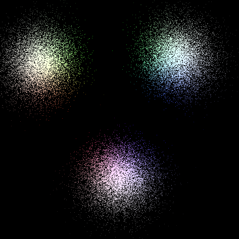
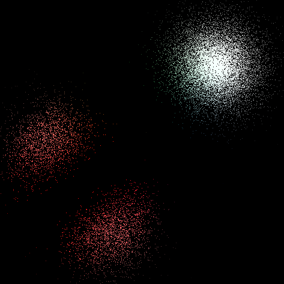
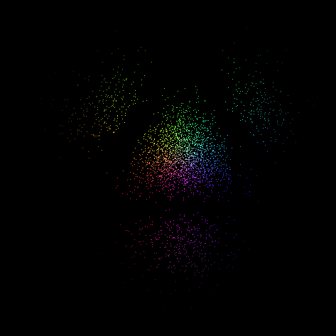

# Sandbox-OpenGL
A sandbox repository for the sake of learning OpenGL in C++.

### PDF Interferences:
A demonstration of three Probability Distribution Functions that will experience destructive interference when in proximity to each other. Each PDF interference has a color associated with it.

To move the PDFs, you can use WASD, IJKL, and the arrow keys.

This is also a poor use of OpenGL.

